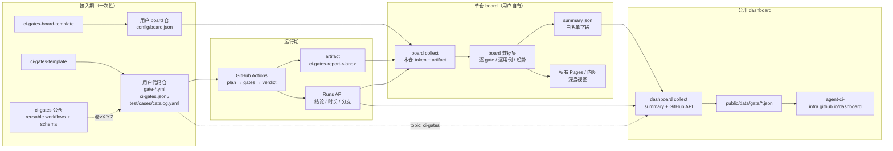
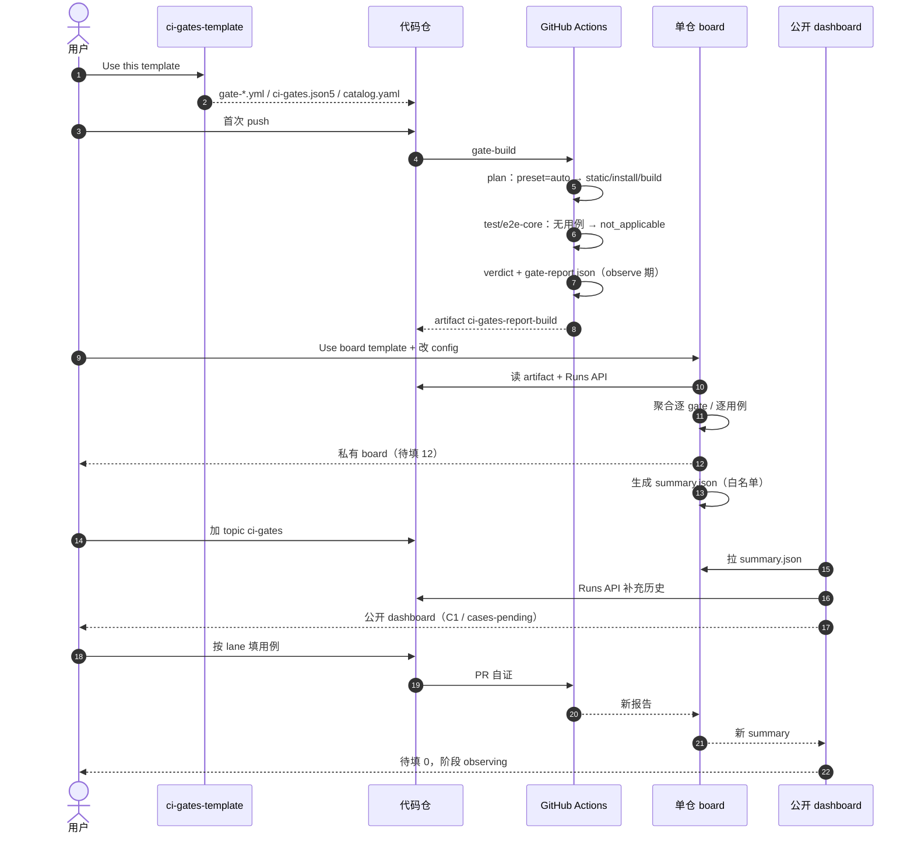
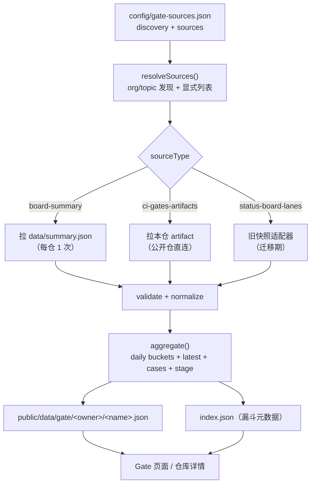

# CI-workflow × 双看板联合方案 v1.1

> 关联文档：`public-ci-repo-design-v3.md`（以下简称 **v3**，CI-workflow 公仓设计方案）
> 关联站点：公开汇总看板 <https://agent-ci-infra.github.io/dashboard/>；单仓看板模板 <https://github.com/agent-CI-Infra/dashboard/tree/main/single-repo>；门禁模板 <https://github.com/agent-CI-Infra/CI-workflow>
> 状态：**历史设计文档**；当前布局以 [`repository-architecture.md`](repository-architecture.md) 为准。
> 2026-10 更新：公开单仓看板已改为本仓 `board/*` 分支托管，不再复制模板到新仓；文中“board 模板 / 独立看板仓”的步骤属于历史设计。
> 命名：仓名已从 `ci-gates` 改为 `CI-workflow`；协议标识 `ci-gates/*`、artifact `ci-gates-reports`、配置 `.github/ci-gates.json` 保留兼容。
> 范围：模板接入 → 门禁运行 → 用例填写 → 私有 board → 公开 dashboard 的端到端闭环

---

## 0. 摘要

v3 解决了「门禁长什么样」和「门禁怎么自动生成」，但没有回答三个衔接问题：

> 刚起步、还没有门禁的仓库从哪一步开始？建好门禁后用例谁来填、填到什么程度算完？填完之后，结果给谁看？

本方案引入**两套看板、一份协议**：

```
模板层     ci-gates-template（门禁模板）· ci-gates-board-template（单仓看板模板，源自 SD board）
门禁层     v3 五条 lane + gate-report.json v1.1
用例层     case-catalog.yaml（按门禁类型登记；todo / ready / not_run 三态）
看板层     私有 board（每仓/每组织一份，深视图）→ summary.json → 公开 dashboard（跨仓汇总）
```

| 看板 | 定位 | 数据范围 | 部署 | 典型用户 |
|---|---|---|---|---|
| **单仓 board（模板）** | 私有大屏 / 深度视图 | 本仓全量：五 lane、逐 gate、逐用例、失败原因、趋势、flaky | 用户自己的仓库 + Pages / 内网静态托管；可私有 | 仓库 owner、QA、值班 |
| **公开 dashboard** | 跨仓横向对比 / 生态视图 | 只消费 board 发布的 `summary.json`；无明细 | `agent-ci-infra.github.io/dashboard` | 组织管理者、外部访客 |

关键点：**明细留在自己的 board 仓**。单仓 board 在自己的仓库里完成采集（用本仓 token 读自己的 artifact），对外只发布一份白名单字段的 `summary.json`；公开 dashboard 只拉 summary，不接触代码、日志、用例标题，也不需要访问私有仓的权限。board 部署在哪里、是否公开，由用户决定。

用户的全部人工动作仍只有三件（若启用单仓 board，再加一次配置）：

1. **点一次「Use this template」**创建门禁仓（可选：再点一次创建 board 仓）；
2. **按门禁类型填用例**（build / pr-ready / pr-merge / daily / release，各填各的层）；
3. **给仓库加 topic `ci-gates`**（让公开 dashboard 发现；不加也不影响门禁和私有 board）。

其余步骤——生成 workflow、首次构建、上报报告、board 采集、summary 发布、公开 dashboard 聚合、页面部署——全部自动。

三条红线：

- **未填的用例不许显示成绿色**：`todo` / `not_run` 是独立状态，不计入通过率；
- **看板不执行任何消费方代码**：只解析报告与 API 元数据；PR 来源标记 `provisional`；
- **明细留在自己的 board，公开只拿 summary**：公开 dashboard 不是"能看所有私仓"的后门。

---

## 1. 目标与非目标

### 1.1 目标

| # | 目标 | 可验收的结果 |
|---|---|---|
| G1 | 新仓 5 分钟内跑起第一条门禁 | 从模板创建后，首次 push 即出现 `build / verdict` |
| G2 | 零配置启动 | 用户不改 workflow、不写 `ci-gates.json5` 也能跑；预设由 `preset: auto` 运行时解析 |
| G3 | 用例按门禁类型组织 | 模板生成 `test/cases/catalog.yaml`，每条用例带 `lane` / `layer` |
| G4 | 未填用例不假绿 | board 与 dashboard 都显示「待填 n」；门禁 observe 期内不误红、到期后不放开 |
| G5 | 每仓一份 board | 从 board 模板创建 → 改一处配置 → Pages 出站；明细留在本仓，对外只发 summary |
| G6 | 公开 dashboard 跨仓汇总 | 只拉 `summary.json`，展示等级 / 五 lane / 用例缺口 / 接入阶段，可跳转各仓 board |
| G7 | 全链路可审计 | 每次裁决可追溯到 run、artifact、报告 JSON 与 catalog 版本 |

### 1.2 非目标

- 看板**不执行**消费方的测试、构建、安装脚本；
- 公开 dashboard **不直接访问**私有仓 artifact，也不要求私有仓 token；
- 看板**不做发布动作**，只展示 release lane 的结果；
- 看板**不替代** GitHub Actions 运行页，深链回 Actions；
- ci-gates **不替消费方写业务用例**，只提供骨架、登记与校验；
- 本期不引入数据库或后端服务——两套看板都是静态站点 + 定时采集；
- board 模板**不内置**任何组织的私有规则，只提供通用能力与配置项。

---

## 2. 角色与总体架构

### 2.1 角色

| 角色 | 仓库 | 职责 |
|---|---|---|
| 规范与引擎 | `agent-dashboard-ai/ci-gates` | 五条 reusable workflow、生成器、报告 schema、用例契约校验器 |
| 门禁模板 | `agent-dashboard-ai/ci-gates-template` | 一键创建起点：薄 workflow + 配置 + 用例骨架 + 填用例指南 |
| 看板模板 | `dashboard/single-repo`（由 SD board 泛化） | 单仓看板：Setup dashboard 填源仓 + JSON，采集、聚合、展示、发布 Pages |
| 消费方 | 用户自己的仓库 | 填用例、改业务代码；门禁由模板提供，不手改 |
| 公开汇总 | `agent-CI-Infra/dashboard`（本仓） | 发现仓库、拉 summary、跨仓聚合、发布 Pages |

### 2.2 架构图



### 2.3 两条数据链路

| 链路 | 适用 | 数据流 |
|---|---|---|
| **A. board 联邦（推荐）** | 任何仓库，尤其私有仓 | 代码仓 artifact → 单仓 board → `summary.json`（公开/白名单）→ 公开 dashboard |
| **B. 直连 artifact** | 公开仓、不想额外部署 board | 代码仓 artifact → 公开 dashboard（直接拉取） |

公开 dashboard 同时支持 A/B，按仓库配置选择；**同一个仓库在同一时间只走一条链路**，避免两套数字。

### 2.4 为什么这样分层

- **权限**：私有仓的 artifact 只有本仓 token 能读；board 跑在用户自己的仓库里，天然有权限。公开 dashboard 不需要任何私有权限。
- **规模**：公开 dashboard 每仓只拉 1 个 summary，而不是 5 个 artifact；100 个仓的采集成本从 ~500 次请求降到 ~100 次。
- **隐私**：summary 是白名单字段（没有用例标题、文件路径、日志），用户可自行决定是否发布。
- **可演进**：board 是"边缘聚合器"，可以按组织定制视图，不影响公开协议。

---

## 3. 端到端用户旅程

### 3.1 六个阶段

| 阶段 | 用户动作 | 系统动作 | 看板显示 |
|---|---|---|---|
| **S0 创建** | 用模板创建代码仓（可选：再创建 board 仓） | 复制薄 workflow、配置、用例骨架、CODEOWNERS 托管块、board 配置 | 尚未发现 |
| **S1 首次运行** | push 第一个提交 | `plan` 探测技术栈 → 解析预设 → 跑 static / install / build；用例相关 gate 因无用例报 `not_applicable` | `gates-running` |
| **S2 单仓 board** | 改 `config/board.json`（仓库名、分支、窗口）；开启 Pages | board 采集本仓 artifact + 运行历史，生成深度视图；发布 summary（可选） | board 可见，阶段 `cases-pending` |
| **S3 公开出现** | 给代码仓加 topic `ci-gates`（或把 summary URL 登记到公开 dashboard） | 公开 dashboard 发现仓库、拉 summary、合并历史 | 公开 dashboard 出现该仓，`待填 n` |
| **S4 填用例** | 按 lane 打开 `test/cases/<lane>/`，实现测试；catalog `todo` → `ready` | PR 触发 build + pr-ready；`case-contract` 校验；报告带 `cases` 计数 | 待填下降；`not_run` 单独标红 |
| **S5 生效** | 观察期结束，合并 `upgrade --enforce` PR；管理员应用 ruleset | observe 转 enforce；required check 生效 | `enforced`；等级 C1/C2 |

### 3.2 时序（首次接入，含 board）



### 3.3 两类起点

| 起点 | 特征 | 模板/生成器处理 |
|---|---|---|
| **greenfield** | 没有测试，只有源码 | 生成 catalog 的 `todo` 条目与各 lane 的 README；`test` / `e2e-core` 先 `not_applicable`；`case-contract` 只做结构校验 |
| **brownfield** | 已有 pytest / vitest / go test / JUnit，但没接门禁 | `init` 只读扫描测试文件，能识别的登记为 `ready`（`source: detected`）；缺失层补 `todo`；首次运行就有真实计数 |

brownfield 扫描只做**静态识别**（文件名、`describe/it`、pytest 函数名、`@Test` 注解），不执行代码；识别不确定时登记 `todo` 并标 `source: detected-unverified`，不猜。

---

## 4. 数据契约

五份契约，全部版本化、向后兼容、可 schema 校验：

| # | 契约 | 生产者 | 消费者 | 可见性 |
|---|---|---|---|---|
| 1 | `gate-report.json` v1.1 | gate lane 的 `verdict` | board / 公开 dashboard | 仓库 artifact（按仓可见性） |
| 2 | `case-catalog.yaml` v1 | 用户 + 生成器 | gate `case-contract`、board | 仓库内 |
| 3 | `board.json` v1 | 单仓 board | board UI | 随部署（建议私有） |
| 4 | `summary.json` v1 | 单仓 board | 公开 dashboard | 公开（可选） |
| 5 | `dashboard-repo.json` v1 | 公开 dashboard | dashboard UI | 公开 |

### 4.1 `gate-report.json` v1.1

v3 已定义 `ci-gates/gate-report@1`（v3 §4.6）。board 与公开 dashboard 需要三个额外信息才能回答「接入到哪一步、用例填了多少」：

| 新增字段 | 类型 | 必填 | 用途 |
|---|---|---|---|
| `preset` | string | 否 | 运行时解析出的预设（`auto` 的结果） |
| `gatesVersion` | string | 否 | 公仓版本，展示与升级提示 |
| `onboarding` | object | 否 | 阶段、观察期截止、catalog 路径 |
| `cases` | object | 否 | 本 lane 用例统计（catalog 三态 + 执行三态） |
| `observe` | array | 否 | 本 lane 处于 observe 的 gate 与到期日 |
| `waivers` | array | 否 | 本 lane 生效的豁免 |
| `run` | object | 否 | run id / attempt / url，便于去重与深链 |

完整示例见**附录 A**。核心语义：

```jsonc
{
  "schema": "ci-gates/gate-report@1",
  "gates": "v1.4.0",
  "gatesVersion": "v1.4.0",
  "repo": "acme/web",
  "sha": "3f9c…",
  "event": "merge_group",
  "lane": "build",
  "level": "C1",
  "preset": "node-web",
  "verdict": "pass",
  "onboarding": { "stage": "cases-pending", "since": "…", "observeUntil": "2026-11-03", "catalog": "test/cases/catalog.yaml" },
  "cases": {
    "catalog": { "total": 20, "ready": 8, "todo": 12, "skipped": 0 },
    "layers": [
      { "name": "L1", "planned": 8, "executed": 8, "passed": 7, "notRun": 1, "todo": 0 },
      { "name": "L3", "planned": 4, "executed": 0, "passed": 0, "notRun": 0, "todo": 4 }
    ]
  },
  "results": [
    { "id": "test", "status": "pass", "metrics": { "cases": 8, "failed": 1, "notRun": 1 } },
    { "id": "e2e-core", "status": "not_applicable", "reason": "no core cases" }
  ],
  "observe": [{ "gate": "coverage", "until": "2026-11-03" }],
  "waivers": [],
  "run": { "id": 18273645, "attempt": 1, "url": "https://github.com/acme/web/actions/runs/18273645" }
}
```

**信任分级**：

| 报告的 `event` | 信任级别 | 使用方式 |
|---|---|---|
| `merge_group` / `push` / `schedule` / `release` | **trusted** | 计入合规等级、接入阶段、趋势、enforce 判定 |
| `pull_request` / `pull_request_target` | **provisional** | 只在 board 的 PR 视图展示；不参与公开 dashboard 的阶段判定 |
| 其他 / 缺失 | **unknown** | 只展示 |

### 4.2 `case-catalog.yaml` v1

**「哪些用例必须存在」的唯一事实源。** 位置 `test/cases/catalog.yaml`（可配置），由 `ci-gates init` 生成，用户只改 `status` 与 `file`。

```yaml
schema: ci-gates/case-catalog@1
version: 1
cases:
  - id: auth.login.success
    lane: build
    layer: L1
    title: 正确凭证可以登录
    status: ready                 # ready | todo | skipped
    file: test/unit/auth.test.ts
    runner: 'auth.test.ts::login succeeds'
    tags: [unit, fast]
    owner: '@alice'
    source: detected              # detected | detected-unverified | generated | manual

  - id: checkout.core.flow
    lane: build
    layer: L3
    title: 结账主流程（核心子集）
    status: todo
    file: test/e2e/checkout.spec.ts
    tags: ['@core']
    source: generated

  - id: staging.smoke.login
    lane: pr-merge
    layer: L4
    title: staging 登录冒烟
    status: todo
    file: test/env/smoke.spec.ts
    source: generated
```

| 字段 | 约束 |
|---|---|
| `id` | 稳定、全局唯一、点分小写；发布后不可改名（改名 = 降级） |
| `lane` | `build` / `pr-ready` / `pr-merge` / `daily` / `release` |
| `layer` | `L0`–`L5`；release 可用 `L1-L4` 表示全量范围 |
| `status` | `ready` 必须能被 `runner` 定位；`todo` 可无实现；`skipped` **必须**带 `until`（≤ 90 天）与 `reason` |
| `runner` | JUnit `classname::name`、pytest `file::test_func`、go `TestXxx`；解析失败按 `not_run` |
| `tags` | `@core` 进入 `core.manifest` 候选集 |
| `owner` | `ready` 必填；用于 board「找谁补」 |

状态机：

```
generated/detected ──实现──> ready ──JUnit 命中──> executed ──> passed | failed
       │                       │
       └──暂不实现──> todo      └──临时跳过（有到期日）──> skipped
```

`todo` 不是失败，但**永远不计入通过率**；`skipped` 到期后按 `not_run`（红）。

### 4.3 `board.json` v1（单仓 board 的本地数据集）

board 在自己仓库内聚合，数据**不要求对外**。它是现有 SD board 数据模型的超集：

```jsonc
{
  "schema": "ci-gates/board@1",
  "repo": "acme/web",
  "owner": "acme",
  "name": "web",
  "defaultBranch": "main",
  "generatedAt": "2026-10-22T09:00:00Z",
  "windowDays": 30,
  "level": "C1",
  "preset": "node-web",
  "gatesVersion": "v1.4.0",
  "stage": "cases-pending",
  "boardUrl": "https://acme.github.io/web/",
  "branches": [
    {
      "name": "main",
      "gateStatus": "passed",
      "coverage": 72.4,
      "coverageDetail": { "lines": { "covered": 724, "total": 1000 } },
      "lanes": [
        {
          "id": "build",
          "category": "build",
          "latest": {
            "verdict": "pass",
            "trust": "trusted",
            "event": "merge_group",
            "runId": 18273645,
            "runAt": "2026-10-22T08:10:00Z",
            "runUrl": "https://github.com/acme/web/actions/runs/18273645",
            "sha": "3f9c…",
            "results": [
              { "id": "test", "status": "pass", "durationMs": 182340, "metrics": { "cases": 8, "failed": 1, "notRun": 1 } },
              { "id": "coverage.patch", "status": "observe_fail", "metrics": { "linesPct": 62.5, "threshold": 80 } }
            ],
            "cases": { "catalog": { "total": 20, "ready": 8, "todo": 12 }, "layers": [] }
          },
          "history": [
            { "date": "2026-10-22", "pass": 4, "fail": 0, "ignored": 0, "retries": 1, "durations": [182, 190] }
          ],
          "runs": [
            { "id": 18273645, "conclusion": "success", "event": "merge_group", "durationSec": 182, "createdAt": "…", "url": "…" }
          ]
        }
      ]
    }
  ],
  "caseCatalog": {
    "total": 20, "ready": 8, "todo": 12, "skipped": 0,
    "byLane": { "build": { "ready": 8, "todo": 12 }, "pr-merge": { "ready": 0, "todo": 2 } }
  },
  "waivers": [],
  "observe": [{ "gate": "coverage.patch", "lane": "build", "until": "2026-11-03" }]
}
```

board 可以展示比协议更细的内容（失败摘录、用例标题、文件路径、日志深链），这些**不进入 summary**。

### 4.4 `summary.json` v1（公开契约）

board 对外发布的**唯一**文件，白名单字段，建议放在 board 站点 `data/summary.json`：

```jsonc
{
  "schema": "ci-gates/board-summary@1",
  "repo": "acme/web",
  "owner": "acme",
  "name": "web",
  "defaultBranch": "main",
  "generatedAt": "2026-10-22T09:00:00Z",
  "windowDays": 30,
  "level": "C1",
  "preset": "node-web",
  "gatesVersion": "v1.4.0",
  "stage": "cases-pending",
  "boardUrl": "https://acme.github.io/web/",
  "lanes": [
    {
      "id": "build", "verdict": "pass", "trust": "trusted",
      "passRate": 96.2, "runs": 24, "avgDurationSec": 185,
      "lastRunAt": "2026-10-22T08:10:00Z",
      "lastRunUrl": "https://github.com/acme/web/actions/runs/18273645",
      "cases": {
        "total": 20, "ready": 8, "todo": 12, "skipped": 0,
        "executed": 8, "passed": 7, "notRun": 1
      },
      "history": [
        { "date": "2026-10-21", "pass": 3, "fail": 1, "ignored": 0, "retries": 0, "durations": [180, 192] },
        { "date": "2026-10-22", "pass": 4, "fail": 0, "ignored": 0, "retries": 1, "durations": [182, 190] }
      ]
    },
    { "id": "pr-ready", "verdict": "pass", "trust": "trusted", "passRate": 98.1, "runs": 22, "avgDurationSec": 42 },
    { "id": "pr-merge", "verdict": "not_applicable", "trust": "trusted", "reason": "envVerify disabled" },
    { "id": "daily", "verdict": "pass", "trust": "trusted", "passRate": 91.0, "runs": 12, "avgDurationSec": 620 },
    { "id": "release", "verdict": "not_applicable", "trust": "trusted", "reason": "no tag run in window" }
  ],
  "caseSummary": {
    "total": 20, "ready": 8, "todo": 12, "skipped": 0,
    "executed": 8, "passed": 7, "notRun": 1
  },
  "coverage": 72.4,
  "openWaivers": 0,
  "observeUntil": "2026-11-03"
}
```

**白名单纪律**（board 模板内置，配置不可关闭的字段）：

- 允许：仓库名、分支名、等级、阶段、五 lane 的 verdict / 通过率 / 次数 / 时长、用例计数、覆盖率、观察期、board 链接；
- 禁止：用例标题、文件路径、失败摘录、日志、PR 标题/作者、环境地址、任何密钥或内网地址；
- `summary` 体积目标 < 20 KB，硬上限 100 KB；
- `lanes[].history` 是最近 30 天的日桶（与 dashboard 现有 `daily` 同形），用于客户端按窗口聚合；缺省时适配器用 `passRate × runs` 合成单桶，并在界面上只承诺「最近一次聚合」；
- 可校验的 schema 见 [`protocol/board-summary.schema.json`](../protocol/board-summary.schema.json)，完整示例见 [`protocol/examples/board-summary.json`](../protocol/examples/board-summary.json)；
- 用户可在 board 配置里关闭发布（`publish.summary: false`），此时公开 dashboard 看不到该仓，但私有 board 正常；
- **summary 的可达性 = 公开 dashboard 的可见性**：若 board 部署在私有 Pages 或内网，公开 dashboard 取不到 summary，该仓不会出现在公开视图；需要公开汇总的私有仓，应把 summary 发布到一个公开可达的位置（公开 Gist / 公开 registry 仓 / 公开 Pages 子站），而不是把整个 board 公开。

### 4.5 `dashboard-repo.json` v1（公开 dashboard 数据集）

公开 dashboard 的现有格式（`scripts/collect-gate.mjs` 输出）已经支持 `branchData[].stats[].daily`、`coverage`、`cases`、`recentRuns`。在其上增加仓库级与 lane 级字段，**不破坏现有字段**：

```jsonc
{
  "schema": "ci-gates/dashboard-repo@1",
  "id": "acme/web",
  "name": "web",
  "owner": "acme",
  "defaultBranch": "main",
  "url": "https://github.com/acme/web",
  "generatedAt": "2026-10-22T09:00:00Z",
  "sourceUrl": "https://acme.github.io/web/data/summary.json",
  "sourceType": "board-summary",          // board-summary | ci-gates-artifacts
  "windowDays": 30,
  "level": "C1",
  "preset": "node-web",
  "gatesVersion": "v1.4.0",
  "stage": "cases-pending",
  "boardUrl": "https://acme.github.io/web/",
  "caseSummary": { "total": 20, "ready": 8, "todo": 12, "skipped": 0, "executed": 8, "passed": 7, "notRun": 1 },
  "branchData": [
    {
      "name": "main",
      "gateStatus": "passed",
      "coverage": 72.4,
      "caseSummary": { "total": 20, "ready": 8, "todo": 12, "executed": 8, "passed": 7, "notRun": 1 },
      "stats": [
        {
          "category": "build",
          "daily": [{ "date": "2026-10-22", "pass": 4, "fail": 0, "ignored": 0, "retries": 1, "durations": [182, 190] }],
          "link": "https://github.com/acme/web/actions/runs/18273645",
          "latest": {
            "verdict": "pass", "trust": "trusted", "event": "merge_group",
            "runId": 18273645, "runAt": "…", "runUrl": "…", "sha": "3f9c…",
            "observe": [], "waivers": [], "results": []
          }
        }
      ]
    }
  ]
}
```

索引 `public/data/gate/index.json` 增加漏斗元数据：

```jsonc
{
  "generatedAt": "…",
  "windowDays": 30,
  "sources": [
    {
      "id": "acme/web", "owner": "acme", "name": "web",
      "file": "acme/web.json",
      "sourceUrl": "https://acme.github.io/web/data/summary.json",
      "sourceType": "board-summary",
      "level": "C1", "stage": "cases-pending", "boardUrl": "…",
      "stale": false
    }
  ]
}
```

### 4.6 状态映射与阶段推导

**单 lane 状态**（沿用 v3 封闭枚举）：

| `gate-report` status | 看板含义 | 颜色 |
|---|---|---|
| `pass` | 通过 | 绿 |
| `fail` | 失败 | 红 |
| `not_run` | 计划内未执行 | 红 |
| `not_applicable` | 本阶段不适用（含"未启用"） | 灰 |
| `waived` | 豁免中 | 黄 |
| `observe_fail` | 观察期失败（不阻塞） | 黄 |
| `error` | 门禁自身错误 | 红 |

**仓库阶段** `stage`（board 与公开 dashboard 共用）：

```
discovered      有 topic / 有 ci-gates.json5，但 7 天内没有任何 gate-report
gates-running   有 build 报告，但没有 catalog（或 catalog total = 0）
cases-pending   catalog.todo > 0 或 notRun > 0
observing       catalog 全部 ready，且仍有未到期的 observe
enforced        无 observe / waiver，最近 trusted verdict 全部 pass
failing         最近 trusted verdict 为 fail / error（非 observe、非 waiver）
```

优先级：`failing` > `cases-pending` > `observing` > `enforced`；`discovered` / `gates-running` 只在缺数据时出现。

### 4.7 版本与兼容

| 协议 | 版本 | 兼容策略 |
|---|---|---|
| `gate-report` | `@1` → `@1.1` | 新字段全部 optional；board 缺字段时回退旧行为 |
| `case-catalog` | `@1` | 新增 optional 字段不升版本 |
| `board` / `board-summary` | `@1` | board 与公开 dashboard 各自容忍缺字段 |
| `dashboard-repo` | `@1` | 旧采集器产物仍可被新前端读取 |

破坏性变更（字段改名、枚举收紧）走 v3 §9 的 major 流程；公开 dashboard 先兼容两个版本再切换。

---

## 5. 用例填写模型（按门禁类型）

### 5.1 门禁类型 → 用例层矩阵

「根据门禁类型填用例」的准确含义：**每条 lane 只关心它负责的层**，不要求全量铺开。

| lane | 必填层 | 可选层 | 报告文件 | 模板目录 |
|---|---|---|---|---|
| **build** | L1 单元；L3 e2e-core（`@core`） | L0 契约、L2 构建产物 | `reports/junit.xml`、`reports/e2e-core.xml` | `test/cases/build/` |
| **pr-ready** | 无执行用例；契约与静态检查 | SARIF 汇总 | `reports/case-contract.json` | `test/cases/pr-ready/README.md` |
| **pr-merge** | L4 环境冒烟 | 扩展用例 | `reports/env-smoke.xml` | `test/cases/pr-merge/` |
| **daily** | L3 全量回归；L5 长稳（永不阻塞） | 负向 / 故障用例 | `reports/regression.xml` | `test/cases/daily/` |
| **release** | L1–L4 全量 | 环境全量 | `reports/release-full.xml` | `test/cases/release/` |

约束：

- **pr-ready 不执行 PR 代码**（v3 R4），只做 `case-contract`：catalog 与测试文件双向登记、`todo` 计数、`skipped` 到期检查；
- **build 的 e2e-core 只跑 `@core` 子集**，完整回归在 daily；
- **pr-merge 的 L4 需要环境与密钥**，模板默认关闭（`envVerify` 不配置）；board 显示「未启用」而非「待填」；
- **release 复用前四层**，catalog 中 `lane: release` 的条目只声明「发布前必须全绿」。

### 5.2 模板生成的目录

```text
test/
├── cases/
│   ├── catalog.yaml                 # 唯一事实源（用户改这里）
│   ├── README.md                    # 填用例指南（按 lane 分节）
│   ├── build/
│   │   ├── unit/README.md           # L1：写什么、放哪、怎么被 JUnit 收集
│   │   ├── contract/README.md       # L0：可选
│   │   └── e2e-core/README.md       # L3：@core 标记与 core.manifest
│   ├── pr-merge/
│   │   └── env-smoke/README.md      # L4：默认关闭，启用步骤
│   ├── daily/
│   │   └── regression/README.md     # L3 全量 + 负向
│   └── release/
│       └── README.md                # 全量声明
├── unit/                            # 现有/新增单测（brownfield 复用）
├── e2e/                             # 现有/新增 E2E
└── e2e/core.manifest                # 由 catalog 的 @core 条目生成
```

**catalog 是索引，测试文件是实体**。用户不需要为了「让看板看到」改 workflow 或配置；只要在 catalog 登记 + 写测试，下一轮采集就有数字。

### 5.3 填用例的四个动作

| 动作 | 用户做什么 | 系统校验什么 |
|---|---|---|
| ① 登记 | 在 catalog 增加一条 `status: todo` | schema、`id` 唯一、`lane` 合法 |
| ② 实现 | 在 `file` 写测试；给测试打 `@case <id>` 标记（无标记时用 `runner` 匹配） | `case-contract`：`ready` 必须能在文件里找到标记/匹配；双向登记 |
| ③ 跑通 | 本地跑 lane 命令；PR 触发 build | JUnit 解析：`ready` 未出现 = `not_run`（红） |
| ④ 生效 | 观察期结束，合并 enforce PR | observe 到期、required check 配置（doctor） |

`@case` 标记按框架适配，统一由 `case-contract` 读取：

```ts
// vitest
it('@case auth.login.success 正确凭证可以登录', async () => { … })
```

```python
# pytest
@pytest.mark.case('auth.login.failure')
def test_login_failure(): ...
```

无法加标记的框架退化为 `runner: 'classname::name'` 精确匹配；匹配不到就 `not_run`，不静默通过。

### 5.4 防假绿规则

| 场景 | 处理 | 看板表现 |
|---|---|---|
| catalog `todo` | 不执行、不算失败 | 黄色「待填 12」 |
| `ready` 但 JUnit 无此用例 | `not_run` | 红色「未执行 1」 |
| `ready` 但 JUnit skipped | `not_run` | 红色 |
| `skipped` 未到期 | 不阻塞 | 黄色「跳过至 11-15」 |
| `skipped` 已到期 | `not_run` | 红色 |
| `@core` manifest 条目缺失 | `not_run` | 红色 |
| 整个 `test` gate 无命令 | `not_applicable`（bootstrap） | 灰色「未启用」 |
| observe 期失败 | `observe_fail` | 黄色，不计通过率 |
| waiver 生效 | `waived` | 黄色，带 issue 链接 |

**「无命令」与「有命令但零用例」必须区分**：前者 `not_applicable`（还没启用这层），后者 `not_run`（登记了但没跑）。

### 5.5 看板如何计算「待填」

仓库级 `caseSummary` 由各 lane 报告合并：

```
total   = Σ catalog.total（去重后）
ready   = Σ catalog.ready
todo    = Σ catalog.todo
skipped = Σ catalog.skipped（未到期）
notRun  = Σ (ready − executed) + 到期 skipped
passed  = Σ passed
```

展示规则：

- `todo > 0` → chip「待填 n」；
- `notRun > 0` → chip「未执行 n」（红，优先于待填）；
- `todo = 0 && notRun = 0 && ready > 0` → chip「用例 n/n」（绿）；
- 无 catalog → 不显示 chip（老仓库 / 未接入）。

---

## 6. 单仓 board 模板（源自 SD board）

### 6.1 定位

SD board 目前是 **sciencediscovery 的专属状态板**。把它泛化为模板后，它变成**每仓/每组织一份的私有看板**：

| 能力 | SD board 现状 | board 模板 |
|---|---|---|
| 数据来源 | 第三方快照 `snapshot.json` | 本仓 artifact + GitHub API（可选兼容 snapshot） |
| 仓库范围 | 硬编码 | `config/board.json` 配置，单仓或 org 多仓 |
| 明细 | 五 lane、用例层、覆盖率 | 增加逐 gate 结果、catalog 三态、失败原因、waiver/observe |
| 部署 | 已有 Pages | 模板 + Pages / 内网静态托管 / 本地 |
| 对外 | 全量快照公开 | 私有数据集 + 白名单 `summary.json` |
| 身份 | 单一仓库看板 | 任意仓库的私有看板 |

### 6.2 配置

```jsonc
// config/board.json
{
  "schema": "ci-gates/board-config@1",
  "repo": "acme/web",                    // 或 { "org": "acme" } 多仓模式
  "defaultBranch": "main",
  "windowDays": 30,
  "refresh": { "cron": "23 */6 * * *" },
  "lanes": ["build", "pr-ready", "pr-merge", "daily", "release"],
  "data": { "mode": "artifacts", "artifactPrefix": "ci-gates-report-" },
  "publish": {
    "summary": true,
    "path": "data/summary.json",
    "whitelist": ["level", "stage", "lanes", "caseSummary", "coverage", "boardUrl"]
  },
  "privacy": {
    "showPrLanes": true,
    "showCaseTitles": true,              // 仅 board；summary 永远不含
    "showRunUrls": true
  },
  "links": {
    "board": "https://acme.github.io/web/",
    "dashboard": "https://agent-ci-infra.github.io/dashboard/"
  }
}
```

配置只写**位置与展示偏好**，不写任何密钥；token 由 Actions 注入。

### 6.3 采集与发布

```yaml
# .github/workflows/collect.yml（board 模板）
name: Collect board data
on:
  schedule: [{ cron: '23 */6 * * *' }]
  workflow_dispatch:
permissions:
  contents: write
  actions: read
concurrency: { group: board-collect, cancel-in-progress: false }
jobs:
  collect:
    runs-on: ubuntu-latest
    steps:
      - uses: actions/checkout@v4
      - uses: actions/setup-node@v4
        with: { node-version: '22' }
      - run: npm ci
      - run: npm run collect
        env:
          GITHUB_TOKEN: ${{ secrets.GITHUB_TOKEN }}
          BOARD_CONFIG: config/board.json
      - run: |
          git add public/data
          git diff --quiet --cached || git commit -m "chore(board): refresh gate data [skip ci]"
          git push
```

**部署形态与权限**（关键：`GITHUB_TOKEN` 只能读**本仓** artifact，跨仓必须 PAT / App）。同仓模式下 board workflow 位于代码仓 `.github/workflows/board-collect.yml`，若 board 代码在 `board/` 子目录，各 step 需带 `working-directory: board`；数据提交路径相应改为 `board/public/data`。

| 形态 | 代码位置 | 读 artifact 的凭证 | 适用 |
|---|---|---|---|
| **同仓模式（推荐）** | 代码仓的 `board/` 子目录；board workflow 与 gate workflow 同仓 | 本仓 `GITHUB_TOKEN`（`actions: read` + `contents: write`） | 单仓，尤其私有仓；权限天然正确 |
| **独立 board 仓（单仓）** | 单独的 `acme/web-board` | fine-grained PAT / GitHub App，对代码仓 `actions: read`，放 environment secret | 想让 board 与代码仓解耦；需额外授权 |
| **独立 board 仓（org 多仓）** | 单独的 `acme/gates-board` | org 级只读 token（`actions: read` + `contents: read`） | 组织统一大屏；board 不写别的仓 |
| **本地 / 内网** | 任意 | 本地 `gh` 登录或内网 token | 不想用 Pages；产物是纯静态 `dist/` |

- **同仓模式**是私有仓的默认答案：board 代码放在代码仓里，workflow 用本仓 token 读本仓 artifact，不存在跨仓授权问题；Pages 从 `board/dist` 发布（或 `gh-pages` 分支）。
- **独立 board 仓**必须显式配 PAT / App；不要假设 `GITHUB_TOKEN` 能跨仓。
- **Pages 可见性**：私有仓的私有 Pages 需要 GitHub Enterprise Cloud；否则用内网静态托管（Nginx / S3 内网 / Netlify private）。模板产出纯静态 `dist/`，托管方式无关。
- **summary 发布**：`npm run collect` 同时写 `public/data/board.json` 与 `public/data/summary.json`；`publish.summary: false` 时不写 summary。私有 board 若要进公开汇总，需把 summary 复制到一个公开可达位置（见 §4.4）。

### 6.4 board 页面

| 页面 | 内容 |
|---|---|
| 概览 | 仓库头（等级/阶段/版本）、五 lane 卡片、用例缺口、覆盖率、最近失败、观察/豁免 |
| Lane 详情 | 逐 gate 结果、耗时、通过率趋势、最近运行、失败摘录（仅本地） |
| 用例 | catalog 表格：id / lane / layer / status / owner / 最近执行；待填筛选 |
| 运行 | 最近 N 次运行，深链 Actions；按 lane / 结论过滤 |
| 趋势 | 通过率、覆盖率、用例数、flaky 的历史曲线 |
| 接入 | 阶段时间线、observe 到期、required check 配置建议（doctor 输出） |

board 是**私有明细的归宿**：失败日志、用例标题、文件路径都在这里，不进入 summary。

### 6.5 与 SD board 的迁移

1. 把 SD board 的 `snapshot.json` 适配器抽成 `sources/status-board`，保留兼容；
2. 新增 `sources/ci-gates`（本方案主路径）；
3. 把硬编码的仓库/分支/lane 迁到 `config/board.json`；
4. 新增 `summary.json` 生成器与白名单；
5. SD board 自身作为模板的第一个部署（sciencediscovery 继续用）；
6. 模板仓库 `ci-gates-board-template` 从泛化后的代码生成，带示例配置与部署文档。

---

## 7. 公开 dashboard 改造

### 7.1 现状与差距

| 现状 | 位置 | 差距 |
|---|---|---|
| 数据来自 SD 快照 | `config/gate-sources.json` 的 `status-board-lanes` | 只覆盖一个仓库；不是 v3 协议；无法表达 level / 用例 / 阶段 |
| 五列通过率 + 覆盖率 | `src/features/gate/overview/repo-gate-table.tsx` | 列已与 v3 lane 对齐，但 `build` 列因 SD 无数据长期为空 |
| 用例计数（per layer artifact） | `collect-gate.mjs` 的 `caseLayers` | 绑定 SD artifact 命名；不认 catalog，没有 todo / notRun |
| 失败保留上次有效数据 | `collect-gate.mjs` 的 `catch` | 可直接复用 |
| 静态站点 + Pages | `.github/workflows/deploy.yml` | 部署形态不变，扩展采集 |

结论：**不重写看板**。五列模型与 v3 天然一致；主要工作在采集器与数据模型，UI 是增量。

### 7.2 目标数据流



### 7.3 来源配置

```jsonc
// config/gate-sources.json
{
  "windowDays": 30,
  "discovery": {
    "orgs": ["agent-dashboard-ai"],
    "topic": "ci-gates",
    "marker": ".github/ci-gates.json5",
    "maxRepos": 200
  },
  "sources": [
    // A. board 联邦（推荐）
    {
      "id": "acme/web",
      "name": "web",
      "owner": "acme",
      "type": "board-summary",
      "summaryUrl": "https://acme.github.io/web/data/summary.json",
      "boardUrl": "https://acme.github.io/web/",
      "defaultBranch": "main"
    },
    // B. 公开仓直连 artifact
    {
      "id": "acme/cli",
      "name": "cli",
      "owner": "acme",
      "type": "ci-gates",
      "defaultBranch": "main"
    },
    // C. 迁移期旧源
    {
      "id": "sciencediscovery",
      "name": "sciencediscovery",
      "owner": "openJiuwen-ai",
      "type": "status-board-lanes",
      "url": "https://sciencediscovery.github.io/github-status-board/data/snapshot.json"
    }
  ]
}
```

`summaryUrl` 可省略：默认按同仓 board 推导为 `https://<owner>.github.io/<name>/data/summary.json`（用户站点 `owner.github.io` 自动去掉 `<name>` 段）。自定义域名或子路径仍需显式配置。

来源优先级：显式 `sources[]` > 组织发现；同一仓库去重，A 优先于 B。

### 7.4 采集器设计

`scripts/collect-gate.mjs` 保持入口，新增 `scripts/lib/ci-gates.mjs`：

```js
// scripts/lib/ci-gates.mjs
export const LANE_TO_CATEGORY = {
  build: 'build',
  'pr-ready': 'ready',
  'pr-merge': 'merge',
  daily: 'daily',
  release: 'release',
}

export async function collectBoardSummarySource(source, opts) {
  const summary = await fetchJson(source.summaryUrl)      // 1 次
  validateSummary(summary, source)                        // schema / repo / size / URL
  const runs = await fetchRepoRuns(source, opts.windowDays) // 1 次分页，补充历史
  return aggregateSummary(source, summary, runs, opts)
}

export async function collectArtifactSource(source, opts) {
  const runs = await fetchRepoRuns(source, opts.windowDays)
  const reports = {}
  for (const lane of Object.keys(LANE_TO_CATEGORY)) {
    const run = latestTrustedRunForLane(runs, lane)
    if (!run) continue
    const artifact = await findArtifact(run, `ci-gates-report-${lane}`)
    if (!artifact) continue
    const report = await downloadArtifactJson(artifact, 'gate-report.json')
    try {
      validateReport(report, source, run)
      reports[lane] = { run, report }
    } catch (error) {
      console.warn(`[gate] skip ${lane} report: ${error.message}`)
    }
  }
  return aggregateArtifacts(source, runs, reports, opts)
}
```

| 约束 | 做法 |
|---|---|
| 请求预算 | board-summary 每仓 1 次 summary + 1 次 runs；直连模式每仓 1 次 runs + 每 lane 1 次 artifact |
| 只拉最新 | 每 lane 只取最近一个 completed run；历史用 runs 列表算，不下载历史 artifact |
| 去重缓存 | 以 `run.id` / `summary.generatedAt` 为键缓存；缓存放 `.cache/gate/`（gitignore） |
| 失败不覆盖 | 复用现有 `catch`：失败保留上次有效 JSON，index 标 `stale: true` |
| 报告缺失 | lane 仍出现，`latest: null`；不把缺失当失败 |
| PR 报告 | 只在 board 展示；公开 dashboard 不采用 |
| 报告过大 | summary ≤ 100 KB；gate-report ≤ 2 MB；超限拒收并 warning |
| 时区 | 日桶继续按 UTC 天切分（与 `collect.mjs` 一致） |

### 7.5 UI 改造

现有表格保持五列，新增三个轻量元素：

1. **仓库名旁**：等级 badge（`C1`）+ 阶段 chip（`待填 12` / `观察中` / `已生效` / `失败`）；
2. **覆盖率右侧**：保持现状；来源优先 summary 的 `coverage`，回退旧适配器；
3. **行点击**：右侧详情抽屉，不新增路由。

```
┌ 仓库 acme/web · C1 · cases-pending · 完整看板 ↗ · GitHub ↗ ──┐
│ [build] 通过 · 96.2% · 24 runs · 3m 02s                       │
│   test pass · coverage observe_fail · size pass               │
│   用例：L1 8/8（7 通过，1 未执行）· L3 0/4 待填              │
│ [pr-ready] 通过 · 98.1% · 防降级 0 · 契约 20 条               │
│ [pr-merge] 未启用（envVerify 未配置）                          │
│ [daily] 通过 · 91.0% · 全量 42 条 · flaky 1                   │
│ [release] 无 tag 运行                                         │
└────────────────────────────────────────────────────────────────┘
```

顶部**接入漏斗**（数据来自 `index.json`，不拉全量）：

```
已发现 12 · 运行中 3 · 待填用例 5 · 观察中 2 · 已生效 2 · 失败 1
```

i18n 新增：`gate.level`、`gate.stage.*`、`gate.cases.todo`、`gate.cases.notRun`、`gate.detail.*`、`gate.funnel.*`、`gate.openBoard`。

### 7.6 采集工作流

```yaml
# .github/workflows/collect-gate.yml（新增）
name: Collect gate data
on:
  schedule: [{ cron: '23 */6 * * *' }]
  workflow_dispatch:
permissions:
  contents: write
concurrency: { group: collect-gate, cancel-in-progress: false }
jobs:
  collect:
    runs-on: ubuntu-latest
    steps:
      - uses: actions/checkout@v4
      - uses: actions/setup-node@v4
        with: { node-version: '22' }
      - run: npm ci
      - run: npm run collect:gate
        env:
          GITHUB_TOKEN: ${{ secrets.GITHUB_TOKEN }}
          GATE_DISCOVERY_ORGS: ${{ vars.GATE_DISCOVERY_ORGS }}
      - run: |
          git add public/data/gate
          git diff --quiet --cached || git commit -m "chore(gate): refresh gate data [skip ci]"
          git push
```

`deploy.yml` 不再每小时跑 `collect:gate`，只构建；数据由独立工作流提交。

### 7.7 安全与隐私

| 风险 | 防线 |
|---|---|
| summary 注入 HTML/脚本 | React 转义；只取白名单字段；不渲染 summary 里的自由文本 |
| summary 伪造（`repo` 乱写） | 以采集配置的 owner/name 为准；不一致拒收 |
| summary 与 run 不对应 | 校验 `summary.lastRunUrl` 指向同仓；`sha` 可选校验 |
| summary 过大 / zip bomb | ≤ 100 KB；只解析 JSON；不下载 artifact |
| 私有仓信息外泄 | 公开 dashboard 只读 summary；board 默认不发布明细；summary 白名单不可配置扩展 |
| Token 泄露 | 公开 dashboard 的 token 只在 Actions；不在产物里；前端不直连 GitHub |
| 频率限制 | 6 小时一轮 + 缓存；匿名兜底只用于极小规模 |
| PR 数据污染 | 公开 dashboard 不使用 PR 报告做阶段判定 |
| 供应链 | 采集器不执行仓库内容，只用 `JSON.parse` / 受限 YAML 解析 |

### 7.8 降级与可观测

- 源失败 → 保留旧数据 + `stale: true`（现有行为）；
- `index.json` 记录 `generatedAt` / `stale` / `errors[]`；
- footer 显示「数据同步自 GitHub · X 分钟前」，stale 时变「上次有效数据 · X 小时前」；
- 采集日志按仓库打印「来源 / lane / 用例 / 耗时」；
- 连续 3 轮失败 → 工作流失败（红），issue 提醒维护者。

### 7.9 与现有社区数据的关系

看板已有社区数据（Stars / Forks / 贡献者 / PR / Issue），仓库标识同为 `owner/name`。两者独立采集、同一实体：

| 数据域 | 列表来源 | 采集器 | 页面 |
|---|---|---|---|
| 社区 | `config/internal-contributors.json` 的键 | `scripts/collect.mjs` | `/`、`/pulls`、`/issues`、`/growth` |
| 门禁 | `config/gate-sources.json` 的 `discovery` / `sources` | `scripts/collect-gate.mjs` | `/gate` |

- **不合并列表**：为了看门禁不应触发社区采集，反之亦然；两份配置各自演进。
- **前端按 `owner/name` join**：有社区数据的仓库在门禁行可显示 Star / PR 链接；没有的只显示门禁，不显示占位。
- **同一仓库两边都有时**：详情抽屉显示「社区摘要 + 门禁摘要」，但数据文件分开，避免一个采集失败阻塞另一个。
- 未来可做 `/repo/<owner>/<name>` 统一详情页；本期不新增路由，保持 `/gate` 单页 + 抽屉。

---

## 8. 自动化流程与责任边界

| 步骤 | 触发 | 自动化 | 人工 | 失败时 |
|---|---|---|---|---|
| 创建代码仓 | 用户点 template | 复制文件 | 起名、可见性 | — |
| 创建 board 仓 | 用户点 template（可选） | 复制 board 代码 + 配置样例 | 改 `config/board.json` | 不影响门禁 |
| 首次门禁 | push / PR | plan → gates → verdict | 无 | 看板 `gates-running`，README 指引 |
| board 采集 | 每 6 小时 | collect + commit + Pages | 无 | 保留旧数据，stale |
| summary 发布 | board 采集后 | 白名单生成 | 无（可关闭） | 公开 dashboard 保留旧 summary |
| 公开发现 | 加 topic | org 发现 + 标记文件 | 加 topic（1 次） | 不显示，不影响门禁 |
| 用户填用例 | 用户 PR | case-contract、JUnit 计数 | **写测试、改 catalog status** | 看板「待填 / 未执行」 |
| 公开刷新 | 每 6 小时 | 拉 summary + 聚合 + Pages | 无 | 保留上次有效数据 |
| 观察期结束 | 到期日 | `upgrade --enforce` 可自动开 PR | 合并 PR | 继续 observe（有到期日） |
| required check | 管理员 | `doctor` 输出 ruleset JSON | 应用一次 | board 显示 `enforced` 但 GitHub 未强制 |

**人工只剩四件事**：加 topic、写用例、改一次 board 配置、应用一次 ruleset。其余全部自动。

---

## 9. 对 ci-gates 公仓的增量

| # | 文件 | 变更 | 里程碑 |
|---|---|---|---|
| 1 | `schema/gate-report.schema.json` | 增加 `preset` / `gatesVersion` / `onboarding` / `cases` / `observe` / `waivers` / `run`（optional） | M1 |
| 2 | `schema/case-catalog.schema.json` | 新增 | M1 |
| 3 | `scripts/lib/case-catalog.mjs` | 读写 catalog、三态校验、`@core` 提取 | M1 |
| 4 | `scripts/verify-case-headers.mjs` | `@case` 标记、双向登记、`runner` 匹配 | M1 |
| 5 | `scripts/plan.mjs` | `generator.preset: "auto"` 运行时探测；多义时 `not_applicable` + 原因 | M2 |
| 6 | 五条 `gate-*.yml` | `verdict` 写 `cases` / `onboarding` / `observe`；artifact 固定 `ci-gates-report-<lane>` | M1 |
| 7 | `generator/templates/` | `test/cases/**`、填用例指南、board 跳转链接 | M1 |
| 8 | `presets/generic.json5` | 增加 `cases.catalog`；模板不用 `__FILL_ME__`（改用 catalog todo） | M1 |
| 9 | `bootstrap.yml` | 模板仓首次生成（可选） | M4 |
| 10 | `ci-gates-template` 仓库 | 由 `generic` + `preset: auto` 生成；README 三步；topic 指引 | M1 |

**与 v3 的关系**：不改变五条 lane、裁决语义、信任模型；只扩展报告协议与用例契约。v3 D-1 ~ D-18 全部保留，新增 D-19 ~ D-25（见 §13.1）。

---

## 10. 对 dashboard 仓的增量（文件级）

| # | 文件 | 变更 | 阶段 |
|---|---|---|---|
| 1 | `config/gate-sources.json` | 增加 `discovery`；`sources[]` 支持 `board-summary` / `ci-gates` | P1 |
| 2 | `scripts/lib/ci-gates.mjs` | 新增：summary / artifact 两个适配器、校验、聚合 | P1 |
| 3 | `scripts/collect-gate.mjs` | 增加分支；抽公共 artifact 下载 | P1 |
| 4 | `.github/workflows/collect-gate.yml` | 新增独立采集工作流 | P1 |
| 5 | `.github/workflows/deploy.yml` | 移除 `collect:gate` | P1 |
| 6 | `src/features/gate/data/gate.ts` | 增加 `GateLevel` / `GateStage` / `GateLatest` / `GateCaseSummary` | P2 |
| 7 | `src/features/gate/data/gate-api.ts` | 解析新字段 | P2 |
| 8 | `src/features/gate/overview/repo-gate-table.tsx` | 等级 badge、阶段 chip、待填、行点击 | P2 |
| 9 | `src/features/gate/components/repo-gate-detail.tsx` | 新增详情抽屉 | P3 |
| 10 | `src/routes/_authenticated/gate.tsx` | 漏斗、抽屉状态 | P2/P3 |
| 11 | `src/lib/i18n.tsx` | 新增 zh/en key | P2 |
| 12 | `scripts/lib/ci-gates.test.mjs` | fixture：summary、report、伪造 repo、超大文件、PR 报告 | P1 |
| 13 | `docs/` | 本文件 + 采集配置说明 | P0 |

**不动的部分**：路由结构、主题、社区数据采集、旧 `status-board-lanes` 适配器（迁移期保留）。

### 10.1 本轮已落地

| 项 | 状态 | 位置 |
|---|---|---|
| `gate-report` v1.1 / `case-catalog` / `board-summary` schema + 示例 | ✅ 已落地 | `protocol/` |
| board summary 校验、阶段推导、数据集归一化 | ✅ 已落地 | `scripts/lib/ci-gates.mjs` |
| 适配器 fixture 测试（18 条） | ✅ 已落地 | `scripts/lib/ci-gates.test.mjs` |
| `validateReport` / `validateCatalog` / `summarizeCatalog` | ✅ 已落地 | `scripts/lib/ci-gates.mjs` |
| 采集器 `board-summary` 分支 + `GATE_SUMMARY_FILE` 离线夹具 | ✅ 已落地 | `scripts/collect-gate.mjs` |
| `config/gate-sources.json` 的 `discovery` 骨架 + 禁用示例源 | ✅ 已落地 | `config/gate-sources.json` |
| 类型 / API 映射（level / stage / caseSummary / latest） | ✅ 已落地 | `src/features/gate/data/gate.ts`、`gate-api.ts` |
| 等级 badge、阶段 chip、待填/未执行、接入漏斗 | ✅ 已落地 | `repo-gate-table.tsx`、`gate-stage-meta.ts`、`gate.tsx`、`i18n.tsx` |
| MVP 门禁运行器 + 五 lane 事件映射 + `gate-report` artifact | ✅ 已落地 | `agent-CI-Infra/CI-workflow`、`.github/workflows/gate.yml` |
| 用例目录解析 + `@case` 校验 + `verify-cases` | ✅ 已落地 | `CI-workflow/scripts/gate/gate.mjs` |
| MVP 运行器测试（7 条） | ✅ 已落地 | `CI-workflow/scripts/gate/gate.test.mjs` |
| 分支保护 / merge queue 自动配置 | ⏳ 需管理员手动 | GitHub Rulesets |
| 独立 `collect-gate.yml`、详情抽屉、直连 artifact 模式 | ⏳ 待做 | — |
| board 模板（`single-repo/`）与 `summary.json` 生成 | 🚧 模板已收进本仓；summary 生成待做 | `single-repo/` |

本地校验：

```bash
npm run test:collector
```

示例源 `acme/web` 默认 `enabled: false`，避免占位数据进入线上；本地预览时临时置 `true`，并设置 `GATE_SUMMARY_FILE=protocol/examples/board-summary.json`，跑完 `npm run collect:gate` 后执行 `npm run dev` 即可在 `/gate` 看到效果（生成物不要提交）。

### 10.2 MVP 门禁模板（已落地）

为了回答“用户现在能不能自动构建门禁”，先落了一版**可运行的 MVP**，不依赖单仓 board 和公开看板：

```text
.github/workflows/gate.yml        # dashboard 自举：一个 job 按事件跑对应 lane
.github/ci-gates.json             # dashboard 自己的 lane 命令
agent-CI-Infra/CI-workflow/
  template/.github/workflows/ci.yml
  template/.github/ci-gates.json
  scripts/gate/gate.mjs
  scripts/gate/gate.test.mjs
  template/test/cases/case-catalog.yaml
single-repo/                      # 单仓/私仓看板模板
test/cases/case-catalog.yaml      # dashboard 自己的用例目录（当前全 todo）
```

能力：

- **事件自动映射**：`pull_request` → build + pr-ready；`merge_group` → build + pr-merge；`push` → build；`schedule` → daily；`release` → release。
- **自动裁决**：任一命令失败，lane `verdict=fail`，job 退出码 1；`enforcement: observe` 则记 `observe_fail` 但不阻断。
- **报告 artifact**：每个 lane 写 `gate-reports/<lane>.json`，符合 `ci-gates/gate-report@1`，上传为 `ci-gates-reports`。
- **用例校验**：`verify-cases` 校验 `ready` 用例必须有 `file` + `owner` + `@case` 标记；`todo` 不要求；未知标记直接失败。
- **分支保护**：管理员把 `CI Gates / gate` 设为 required check；启用 merge queue 后 `merge_group` 自动跑 build + pr-merge。
- **站内入口**：`/gate` 页头「接入门禁」→ `/#/gate-onboarding`；教程页包含复制、配置、用例、required check 四步，并链接模板 README、单仓看板模板与 GitHub 接入申请 issue 模板。

本地验证：

```bash
git clone --depth 1 https://github.com/agent-CI-Infra/CI-workflow.git /tmp/ci-workflow
node --test /tmp/ci-workflow/scripts/gate/gate.test.mjs
node /tmp/ci-workflow/scripts/gate/gate.mjs run --lane build --config .github/ci-gates.json
node /tmp/ci-workflow/scripts/gate/gate.mjs verify-cases --config .github/ci-gates.json
```

边界：运行器只负责跑命令和出报告，不自动改 Rulesets、不自动填用例、不接 board；workflow 的 Node 安装步骤对其他技术栈需要替换。dashboard 自举的 `daily` 以 `observe` 模式跑全量 `npm test` + `build`，现有 4 个与门禁无关的 UI 测试失败只记 `observe_fail`、不阻断；修绿后改成 `enforce`。

---

## 11. 迁移与兼容

| 阶段 | 数据源 | 动作 |
|---|---|---|
| **P0 现在** | SD board（sciencediscovery）+ demo | 保持现状 |
| **P1 双源** | SD board + board-summary | 新增 board 适配器；用本仓作为第一个试点；UI 缺省回退 |
| **P2 切换** | board-summary 为主 | sciencediscovery 的 board 升级为模板，发布 summary；旧 snapshot 适配器保留一个周期 |
| **P3 收尾** | 仅协议 | 删除 SD 专用 `caseLayers` / `laneRules` / `channelMap` |

迁移期原则：

- **不双写**：一个仓库同一时间只有一个主数据源；
- **`stale` 标记**：旧源停更的仓库显示 stale，不静默消失；
- **回滚**：移除 `board-summary` 源即可回到旧适配器。

---

## 12. 里程碑与验收

| 里程碑 | 范围 | 验收标准 |
|---|---|---|
| **P0 设计** | 本文件 | 评审通过；ci-gates 侧确认 §9 的协议增量 |
| **P1 board 模板** | SD board 泛化 + gate-report 适配 | 单仓 board 从模板创建，改一处配置即可展示五 lane / 用例 / 覆盖率；summary 可发布 |
| **P2 公开联邦** | dashboard 消费 summary | 公开 dashboard 出现 1 个通过 board 接入的仓库；等级 / 阶段 / 待填正确；可跳转 board |
| **P3 用例闭环** | catalog 脚手架 + build lane 用例 | 新仓从模板创建 → `not_applicable` → 填 3 条用例后计数正确；board 与 dashboard 的「待填」同步递减 |
| **P4 多仓与发现** | org 发现 + 5 个仓 | 加 topic 即被发现；漏斗正确；单轮采集 < 5 分钟 |
| **P5 体验与收尾** | 详情抽屉、趋势、迁移 | 能从公开 dashboard 下钻到 board / lane / gate / 用例 / run；旧源可下线 |

**第一个试点仓就是本仓**：dashboard 自己用 vitest + ESLint + vite build，正好是 `node-web` 预设的 brownfield 场景。它既验证门禁模板，也验证"自己的 board 展示自己"。

### 12.1 第一批 PR 拆分（建议）

| PR | 仓库 | 内容 | 依赖 |
|---|---|---|---|
| **PR-1** | ci-gates | 报告 schema v1.1 + `case-catalog` schema + `verdict` 写入 `cases` / `onboarding` | — |
| **PR-2** | ci-gates | 模板生成 `test/cases/**` + 填用例指南 + `preset: auto` | PR-1 |
| **PR-3** | board 模板 | SD board 泛化：`config/board.json` + ci-gates source + summary 白名单 | PR-1 |
| **PR-4** | dashboard | `board-summary` 适配器 + 独立采集工作流 + fixture 测试 | PR-3 或 fixture 先行 |
| **PR-5** | dashboard | 类型 + 等级/阶段 badge + 漏斗 + 详情抽屉 | PR-4 |
| **PR-6** | dashboard | 本仓接入门禁模板与 board（dogfood） | PR-1/2/3 |

PR-4 可以先用 fixture 与 PR-3 并行开发，不必等 board 模板合并；PR-5 在数据契约稳定后即可开始。

---

## 13. 风险、开放问题与决策

### 13.1 新增决策

| ID | 决策 | 理由 |
|---|---|---|
| **D-19** | 看板只消费 `gate-report` / `case-catalog` / `summary` + GitHub API | 避免第二个配置中心；延续 v3 D-17 |
| **D-20** | 模板优先、`preset: auto` 运行时解析、默认 observe | 早期仓库没有精力做配置；先跑起来，再收紧 |
| **D-21** | `case-catalog.yaml` 是「必须有哪些用例」的唯一事实源 | 让「填用例」可量化、可校验、可看板化 |
| **D-22** | `todo` / `not_run` 永不显示为通过；无命令与零用例严格区分 | 防止「门禁绿了但其实没测」 |
| **D-23** | 看板合规判断只信 trusted 事件；PR 报告标 provisional | PR 内容可被作者控制 |
| **D-24** | 私有明细留 board，公开只拿白名单 summary | 隐私、权限、规模三者兼得 |
| **D-25** | board 是边缘聚合器，公开 dashboard 是联邦汇总 | 私有仓无需给公开看板授权；公开采集成本降一个量级 |

### 13.2 开放问题

| ID | 问题 | 建议默认 |
|---|---|---|
| **Q16** | 门禁模板是一个通用仓还是每栈一个？ | 先通用（`generic` + auto），M2 再按需拆 |
| **Q17** | 各框架 `@case` 标记适配成本 | 先 vitest / pytest / go test；其余 `runner` 精确匹配 |
| **Q18** | 公开发现用 topic 还是组织清单？ | topic `ci-gates` + 标记文件双条件；配置兜底 |
| **Q19** | 私有仓如何看板化？ | 默认**同仓模式**（代码仓 `board/` 子目录 + 本仓 `GITHUB_TOKEN`）；公开汇总仅在用户主动发布 summary 时可见 |
| **Q20** | 私有 board 的 Pages 可见性？ | 私有 Pages 依赖 GitHub Enterprise Cloud；否则内网静态托管；若需进公开汇总，summary 单独发布到公开可达位置 |
| **Q21** | 公开 dashboard 是否展示 PR lane？ | 不展示，只展示 trusted lane 的汇总；明细去 board |
| **Q22** | 观察期默认多长？ | 14 天；上限 90 天（沿用 v3 D-18） |
| **Q23** | board 是多仓（org）还是单仓？ | 模板支持两者；默认单仓，org 模式用只读 token |
| **Q24** | summary 的发现方式？ | 显式 `summaryUrl` 优先；同组织用 topic `ci-gates-board` 自动发现 |
| **Q25** | board 模板以独立仓分发还是代码仓子目录？ | 两种都支持；默认同仓 `board/`（权限简单），独立仓作为进阶选项 |

### 13.3 风险

| 风险 | 影响 | 缓解 |
|---|---|---|
| board 模板与 SD board 分叉 | 维护两份 | 以 SD board 为上游，模板由同一代码生成；golden 快照 |
| `preset: auto` 误判 | 跑错命令 | 多义即 `not_applicable` + 原因；报告记录 `presetResolved`；可覆盖 |
| summary 字段被要求扩张 | 私有信息外泄 | 白名单写死在模板里，配置不能扩展；新增字段走协议评审 |
| 用例登记与测试代码不同步 | 数字失真 | `case-contract` 双向校验；`not_run` 红；PR 自证 |
| board 与公开 dashboard 数字不一致 | 用户困惑 | 同源：board 是唯一聚合点，公开只读 summary；直连模式只用于无 board 的公开仓 |
| 公开 dashboard 被误认为"能看所有仓" | 隐私质疑 | 页面明确"仅展示已发布 summary 的仓库"；无 summary 不显示 |
| 公开仓报告含敏感信息 | 泄露 | 报告 schema 白名单；文档提示不要放密钥/内网地址 |

---

## 附录 A：`gate-report.json` v1.1 完整示例

```json
{
  "schema": "ci-gates/gate-report@1",
  "gates": "v1.4.0",
  "gatesVersion": "v1.4.0",
  "repo": "acme/web",
  "sha": "3f9c2a1b7d4e5f60718293a4b5c6d7e8f9012345",
  "event": "merge_group",
  "lane": "build",
  "level": "C1",
  "preset": "node-web",
  "verdict": "pass",
  "onboarding": {
    "stage": "cases-pending",
    "since": "2026-10-20T08:00:00Z",
    "observeUntil": "2026-11-03",
    "catalog": "test/cases/catalog.yaml"
  },
  "cases": {
    "catalog": { "total": 20, "ready": 8, "todo": 12, "skipped": 0 },
    "layers": [
      { "name": "L1", "planned": 8, "executed": 8, "passed": 7, "notRun": 1, "todo": 0 },
      { "name": "L3", "planned": 4, "executed": 0, "passed": 0, "notRun": 0, "todo": 4 }
    ]
  },
  "results": [
    { "id": "test", "status": "pass", "durationMs": 182340, "metrics": { "cases": 8, "failed": 1, "notRun": 1 } },
    { "id": "coverage.patch", "status": "observe_fail", "enforcement": "observe", "metrics": { "linesPct": 62.5, "threshold": 80 }, "evidence": ["coverage/lcov.info"] },
    { "id": "e2e-core", "status": "not_applicable", "reason": "no core cases in catalog" }
  ],
  "observe": [{ "gate": "coverage.patch", "until": "2026-11-03" }],
  "waivers": [],
  "run": { "id": 18273645, "attempt": 1, "url": "https://github.com/acme/web/actions/runs/18273645" }
}
```

## 附录 B：`case-catalog.yaml` 最小示例

```yaml
schema: ci-gates/case-catalog@1
version: 1
cases:
  - id: auth.login.success
    lane: build
    layer: L1
    title: 正确凭证可以登录
    status: ready
    file: test/unit/auth.test.ts
    runner: 'auth.test.ts::login succeeds'
    tags: [unit, fast]
    owner: '@alice'
    source: detected

  - id: checkout.core.flow
    lane: build
    layer: L3
    title: 结账主流程
    status: todo
    file: test/e2e/checkout.spec.ts
    tags: ['@core']
    source: generated
```

## 附录 C：`summary.json` 最小示例

```json
{
  "schema": "ci-gates/board-summary@1",
  "repo": "acme/web",
  "owner": "acme",
  "name": "web",
  "defaultBranch": "main",
  "generatedAt": "2026-10-22T09:00:00Z",
  "windowDays": 30,
  "level": "C1",
  "preset": "node-web",
  "gatesVersion": "v1.4.0",
  "stage": "cases-pending",
  "boardUrl": "https://acme.github.io/web/",
  "lanes": [
    { "id": "build", "verdict": "pass", "passRate": 96.2, "runs": 24, "avgDurationSec": 185, "lastRunAt": "2026-10-22T08:10:00Z", "lastRunUrl": "https://github.com/acme/web/actions/runs/18273645" },
    { "id": "pr-ready", "verdict": "pass", "passRate": 98.1, "runs": 22, "avgDurationSec": 42 }
  ],
  "caseSummary": { "total": 20, "ready": 8, "todo": 12, "skipped": 0, "executed": 8, "passed": 7, "notRun": 1 },
  "coverage": 72.4,
  "openWaivers": 0,
  "observeUntil": "2026-11-03"
}
```
