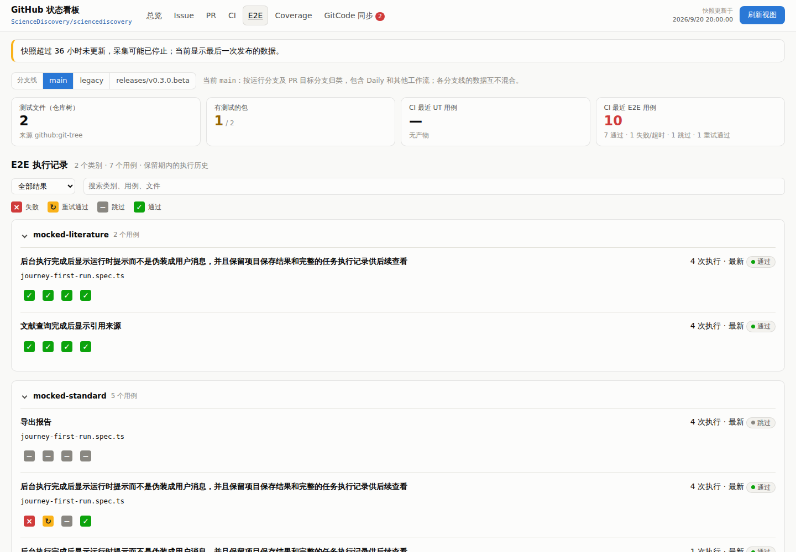
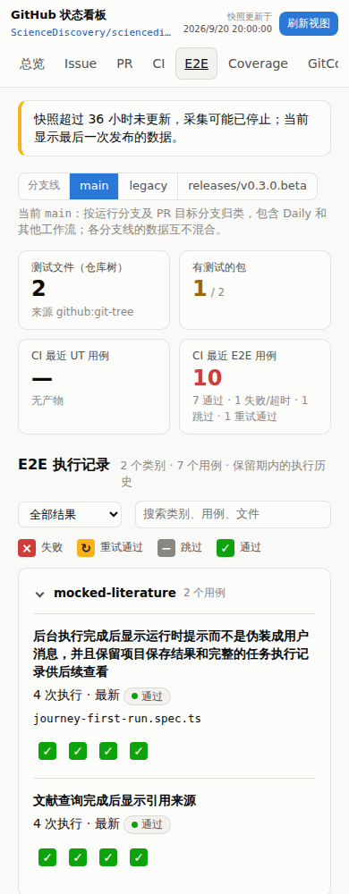

# 页面与交互

看板只展示已采集的稳定状态，不运行测试。页面依次为：总览、Issue、PR、CI、E2E、Coverage、GitCode 同步（见 [GitCode 同步记录](gitcode-sync.md)）。配置了[分支线](branch-lines.md)时，CI、E2E、Coverage 页首可在 main、legacy 与 release 分支之间切换，每次只显示一条分支线。旧的“看板”“构建报告”“历史数据”页已移除；看板形式并入 Issue 与 PR 页，历史分片仍作为采集器的存储保留。

页首显示快照时间。没有数据变化的采集不改快照时间，新的 UTC 日期会重建一次，Bot 至少每 8 小时采集一次；所以快照超过 36 小时未更新时，页面提示采集可能已停止。

## 总览

总览面向“今天要处理什么”，从上到下依次展示以下内容。

**需要处理的问题**，按严重程度排序：

- 主干 CI 连续失败或最近一次失败。
- 每日构建最近一次失败，或超过 36 小时没有运行。
- 最新版本没有提交一致的验证运行，或验证失败。
- 开放 PR 的检查失败、评审超期或存在冲突。
- 其他分支线最近一次 push / 手动运行失败。

CI、PR、Issue 数据不可读取时显示“状态未知”，不会显示为正常。较低优先级的提示（标签化用例从未覆盖、Issue 零回复或陈旧、大量未发布提交、默认分支未保护）折叠在“其他提示”中。

**流水线**（默认分支线）：PR 门禁、主干、每日构建、版本构建四张卡片，给出最近一次运行的结论、时间、工作流、耗时和近 30 天成功率。下方是近 14 天的 PR、主干、合并队列、Daily、版本五层图，与 CI 页同一数据，[CI 分层历史](ci-history-lanes.md)有详细说明。

**交付与质量**：

- 开放 PR（评审超期、检查失败、30 天合并）。
- 开放 Issue（7 天新增 / 关闭、陈旧）。
- 主干门禁用例（最近一次各层通过 / 计划数）。
- 整仓行覆盖率。
- 最新版本及其后的未发布提交数。

**版本质量**列出最近三个版本的验证运行结论；**最近动态**列出最近合并的 PR 和新建的 Issue。

## Issue 与 PR

统计信息在上，其下是“每日趋势”，再往下是列表。

**每日趋势**画出每天的新增、关闭和存量；PR 页把关闭拆成“合入”和“关闭未合入”。
- **两张图共用时间轴**：每日数量和存量（当天结束时仍开放）量级相差大，分成上下两张图，不用双纵轴。
- **时间范围**：默认最近 30 天，可选近 7、30、90 天、全部，或在日期框里指定起止日期。
- **数据开关**：每条数据各有一个开关；关掉存量时只剩每日数量图。
- **查看某一天**：鼠标悬停或聚焦后用左右方向键（Home／End 到两端）逐日查看，两张图同时出现十字线，提示框列出当天各项数值；“按日数据”表格列出所选范围的全部数值。
- **口径**：按 UTC 日期统计。存量按每个 Issue／PR 当前的创建、关闭时间回推，关闭后又重开的从创建起都算开放。历史尚未回填完时，说明里会提示较早日期可能偏少。
- 范围和开关只保存在当前页面，重新打开回到最近 30 天；定时刷新数据时保留。

**开启时长**饼图与开放列表标题、切换及筛选条同一行（窄屏上下堆叠），四桶使用分类色 `--s2`、`--s4`、`--s7`、`--s3`：按创建时间把当前开放项分进 `<7d`、`7-30d`、`30-90d`、`>90d` 四桶（边界与采集器的年龄统计一致），图例同时给出数量和占比；`age_days` 缺失的项不计入，数量为 0 的桶只在图例里列出、不可点。点击扇区或图例只筛选本页下方的开放列表（表格和看板都吃同一个筛选），再点一次选中的扇区取消；筛选与搜索、标签、认领人等条件同时生效（取交集），Issue 与 PR 的选择互不影响。筛选生效时筛选条出现当前时长桶，可点 × 清除；结果为 0 时列表显示空状态，饼图保持可见。“最近更新”“最久未动”两张卡已从 Issue 页去掉；开放 Issue 表默认按更新时间 `updated_at` 从新到旧，缺失时间排最后，用户可点表头改排序，刷新页面恢复默认。PR 的“最近合并”仍不受开放时长筛选。Issue 页用这张图代替原来的“年龄分布”条形图。

数据由看板仓的采集在 Actions 中算好写进快照，不读 Bot 的数据库，计算方式见[增量同步与历史](incremental-history.md)。

列表可在“表格”和“看板”之间切换，选择保存在本浏览器。

- **表格**：保留原来的只读列表和筛选。
- **看板**：只显示本页类型的工作项，含最近关闭的；分组、筛选和“等高列”偏好也按类型分别保存。

看板的状态、优先级、迭代、备注和列设置仍只写本浏览器存储，可导入 / 导出，不写回 GitHub。列内容超出高度时各列独立滚动，定时刷新后保留滚动位置。

## 测试与 Coverage

E2E 页展示：

- 测试文件与最近一次 UT / E2E 用例数；
- Real E2E 质量评分：顶部是最近两天的 Nightly、最近一次 `real-e2e-results` 的出处和四个汇总数字；下面与 E2E 执行记录同一种排版，按评分体系（DeepResearchBench、BiomniBench、Research Team、PUCT Compression）分类，类别可收起，每个用例一排 ✓／×，按时间从左到右表示每次记录的交付结果，悬停或聚焦显示日期、交付、评分状态、各项分数、耗时和 run，点击打开该 run。每个用例下方直接画出每项分数和运行耗时的历史曲线，并标出最新值；分数曲线从首次成功实测开始；此前的失败仍保留在状态轴上，不在曲线虚构零分。首次实测后的交付失败画红色 × 并用虚线沿用上次实测；后续缺失评分的 × 与上次有分数的运行平齐，虚线经过缺失运行连接到下次实测，提示注明缺失原因和它不是本次测量值，不补零。历史为该分支线每个用例最近 30 个运行日（每天取一次运行）。质量分数仅供观察，不改变 CI 结论；点击用例名打开该用例的旅程报告页 `real-e2e.html`，列出场景、前置条件、评分表和执行历史。
- 保留期内 E2E 运行的[执行记录](e2e-run-records.md)：按类别和用例汇总的执行状态时间轴、各次步骤与错误摘要，及历史点直接跳转的 HTML 附件；
- [标签化测试](tagged-tests.md)；
- 按层 / 包的测试文件分布，以及按包的测试结构。

除最近一次 Real E2E 评分和保留期内的 E2E 执行记录外，逐次运行的明细和覆盖率不在 E2E 页展示。

Coverage 页按语言展示整仓汇总、每日趋势、目录树和最近 PR 结果。原来按覆盖率分组列出的“路径覆盖率”表已并入目录树：每个分组就是一个目录，树上同一目录的数值与该分组完全相同。

目录树按目录逐层展开到单个文件，列出行、分支（Node.js 另有函数）覆盖率和已覆盖 / 总行数：

- 目录的数值是其下所有文件按计数相加，不是百分比平均。
- 只有一个子目录的链会合并为一行，例如 `apps/web/src/`。
- 可切换“按名称”或“行覆盖率从低到高”排序，每一层分别排序，没有行数据的路径排在最后；选择保存在本浏览器。
- 路径过滤按路径子串匹配，过滤时自动展开匹配项。
- 展开状态在定时刷新后保留。
- 标题行给出一条“最新数据”来源：各路径所取结果中最新的时间与提交，不再逐行列出来源。

目录树的数据来自源仓覆盖率摘要中的 `sources` 列表，每项为仓库相对路径加该文件自己的 totals。当前值与整仓结果口径一致：以最新完整基线的文件为底，每个主干增量替换它所测分组下的文件；PR 结果不改变主干视图。其他分支线只用自己运行的摘要，见[分支线](branch-lines.md)。摘要没有 `sources` 时（上游合入逐文件数据之前的主干，以及尚未同步该改动的分支），目录树改用摘要自带的覆盖率分组构建，只展开到分组目录，并在标题中注明。

## 页面入口

「测试」标签改为「E2E」，仍使用 `#tests`，已有报告的返回链接和收藏地址继续可用。版本验证与运维两个标签页及其页面已移除；总览保留已有的版本质量摘要，版本详情改为直达 GitHub，版本构建卡片跳到 CI 页。访问旧的 `#releases`、`#ops` 或未知标签会回到总览，避免空白页。采集数据与历史分片不因页面调整而删除。

以下为隔离样例的桌面和窄屏页面：





## 验证

```bash
PYTHONDONTWRITEBYTECODE=1 python3 -m unittest discover -s tests -v
node .e2e/node_modules/playwright/cli.js test --config test/playwright.config.cjs
```

浏览器用例覆盖：

- 总览的问题排序与数据缺失时显示“状态未知”；
- Issue / PR 的表格 / 看板切换、按类型隔离、本地字段与导入导出；
- Issue / PR 开启时长饼图：桶边界与数量、扇区／图例点击与再点取消、与文本搜索取交、两页选择互不影响、看板视图同一筛选、空结果、Issue 更新时间默认降序与 PR 最近合并不受影响；
- Issue / PR 每日趋势：默认 30 天、预设与自定义范围、刷新后保留范围、数据开关、悬停与方向键查看、整数刻度、按日表格，以及 390px 下不溢出；
- 看板列独立滚动与刷新后保留位置；
- 覆盖率目录树的展开、收起、过滤、按覆盖率排序，以及无逐文件数据时按分组展示；
- 分支线切换及各线数据互不混合；
- E2E 导航、旧报告返回入口、已移除标签的回退与总览版本外链；
- 窄屏布局。

`tests/test_coverage.py` 验证逐文件数据随基线与增量组合；`tests/test_work_trend.py` 验证每日趋势的计算。
